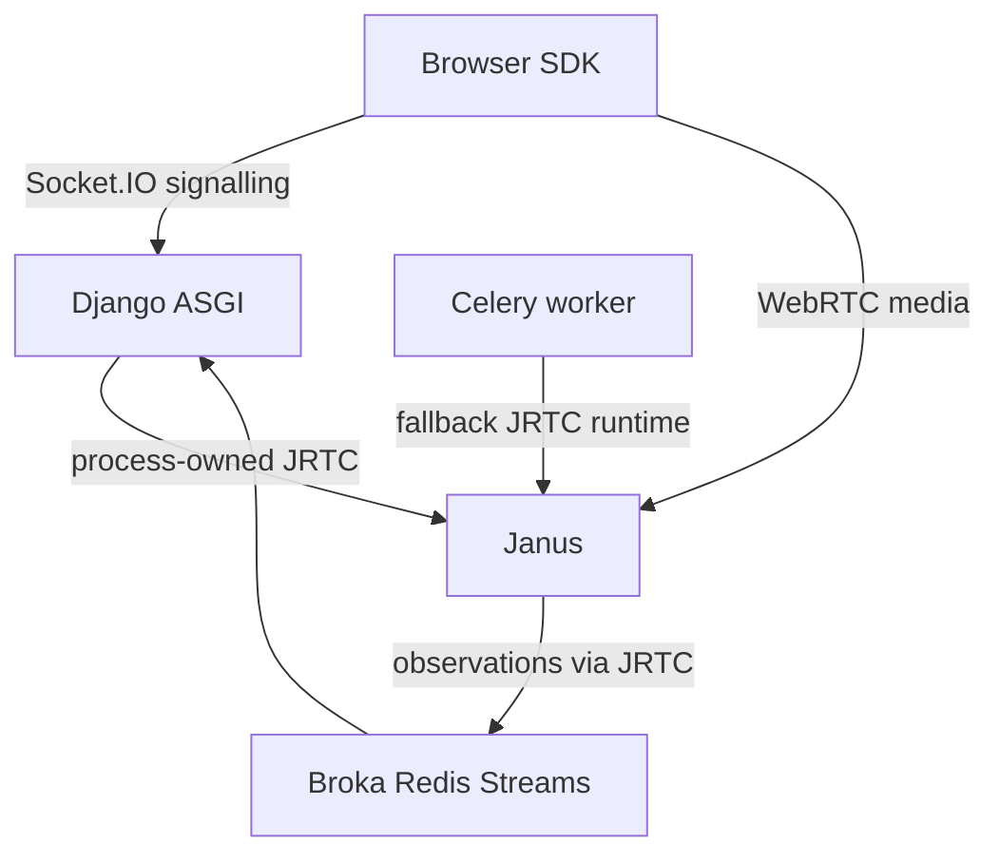

# SG-00 — Baseline and ownership audit

- Date: 2026-10-28 (Africa/Lagos).
- Status: DONE; read-only baseline and instruction import, not runtime migration.
- Build target: user-provided `Leydotpy/jrtc-signalling`, initially empty; local
  implementation branch `codex/gateway-foundation`. No existing AGENTS or code.
- Commit: see this task's entry in `tracking/progress.json` (recorded in the next
  tracking commit, to avoid a self-referential commit SHA).

## Exact source baselines

| Repository | Ref | Commit | Worktree |
| --- | --- | --- | --- |
| synq | v4 | `602eb4237c2e83cfd5b75d362c6a5cd643c70c53` | clean fresh clone |
| synq.js | codex/batched-ice-meeting-sounds | `6521187857da9f8d9223e67b445d71114e935ab0` | API-pinned source snapshot; no git worktree |
| jrtc | main | `cdde8bdb718af71d86b075f74a3ce2b26f12585b` | clean fresh clone |
| jrtc-plugins | main | `0999a1a9de5c60ac879f175b35c12f65fb369915` | clean fresh clone |

Public clones' remotes are `https://github.com/Leydotpy/<repository>.git`.
Private SDK git transport was unavailable; GitHub API confirmed the branch SHA
and recursive tree. All 62 client/package/config source files used for inspection
and tests were checked against those Git blob SHAs. This is not a full frontend
checkout or app verification. Existing root AGENTS (and jrtc-video/AGENTS) were
read. No source or committed dependency file in these repositories was edited.

## Current topology and extraction seams

Evidence paths and line numbers refer to the pinned commits above:

- Synq `src/conf/asgi.py:44`: Starlette lifespan owns JanusProcessRuntime.
  `src/conf/celery.py:18,28` resets inherited runtime after fork and stops worker
  runtimes. `src/apps/meetings/jrtc/runtime.py:323,413,544` exposes ASGI lifespan,
  fallback loop and session resolution. Both process types can currently create
  Janus sessions; gateway cohorts need explicit exclusive ownership before use.
- `src/apps/meetings/jrtc/handles.py:257,356,427` attaches, fences calls and
  detaches process-owned bindings. `services/signaling.py:96,168` fences state
  commands transactionally; `services/janus.py:394` reconciles ownership.
- `src/apps/meetings/realtime/namespace.py:198-253`: publish, unpublish,
  sync-subscriptions, start-subscriber, trickle. Publish selects join-and-configure,
  publish or configure based on live handle state (`services/signaling.py:1196`).
- `src/apps/meetings/jrtc/ice.py:14`: strict 32 candidates / 64 KiB; final
  candidates and completion are independent actions. `videoroom/adapter.py:243`
  sends the batch, then completion. Do not lose the final nonempty batch.
- `src/apps/meetings/jrtc/config.py:96` and `conf/settings/base.py:356` select
  durable Redis Streams by default. Broker factory/publisher in `jrtc/broker.py`;
  existing receipts and browser outbox in `jrtc/events/consumer.py`,
  `idempotency.py`, `dispatcher.py`. They concern legacy Janus observations,
  not the new Django command outbox or authoritative grants.
- SDK `packages/client/src/coordinator/connection/index.ts`: MeetingConnection
  combines HTTP admission/state and Socket.IO media commands. Existing snapshot
  route is `sessions/{session_id}/state/`; preserve SessionStatePayload and
  event_context semantics. `gen/coordinator/index.ts` defines command fields;
  `rtc/IceCandidateBatcher.ts` uses 25 ms / 16-candidate defaults.
- SDK `rtc/SubscriberPeerConnection.ts` consumes unsolicited JSEP but avoids
  double negotiation for transaction-correlated events. Decimal-string IDs are
  enforced in `gen/rtc/index.ts`; no JavaScript numeric conversion is safe.
- JRTC `src/jrtc/manager.py:37`, `session/base.py:255` provide manager and
  additional loss observers; `lib/plugins/base.py:517,539` accept candidate
  sequences and explicit completion. VideoRoom `src/jrtc_video/service.py:374`
  owns reusable service/participant handles. Reuse these, not Synq model wrappers.

## Baseline verification

| Source | Exact command / environment | Result |
| --- | --- | --- |
| synq | `uv run --frozen --python 3.14 python src/manage.py test apps.meetings.tests.test_jrtc_signaling_contracts apps.meetings.tests.test_jrtc_contracts apps.meetings.tests.test_jrtc_persistence_contracts apps.meetings.tests.test_runtime_lifecycle_contracts apps.meetings.tests.test_jrtc_event_plane apps.meetings.tests.test_realtime_namespace --settings=conf.test_settings` | 78 passed, SQLite test settings, Python 3.14.8 |
| jrtc | `uv sync --frozen --all-extras --group dev`; `uv run --frozen pytest -q` | 110 passed, 3 skipped (optional jsrv checkout unavailable), Python 3.12.14 |
| jrtc-video | `uv run --frozen --python 3.12 --extra test python -m pytest tests -q` | 33 passed |
| SDK | `tsc -p packages/client/tsconfig.json --noEmit`; `tsc -p packages/client/tsconfig.test.json`; `node --test packages/client/test/*.test.cjs` | typecheck passed; 34 tests passed |

Initial unrestricted Python selection chose 3.15 and dependency installation
failed for Synq/VideoRoom wheel availability. Explicit supported Python versions
resolved this without changing source or locks. VideoRoom's committed uv lock
still records 3.0.3 while package metadata is 3.0.4; tests use the local source,
but release lock refresh belongs to that repository. JRTC source is 3.3.0; Synq
pins older JRTC/VideoRoom commits in its own lock. SDK tests use TypeScript 5.9.3
and socket.io-client 4.8.1, without changing its package manifest.

## Dependencies and limits

- No Django gateway ticket issuer, authorization_epoch grant API, gateway command
  outbox, gateway routing cohort, or SSE projection endpoint was found in the
  inspected sources. SG-03/05/06/11/12 are external implementation prerequisites.
- No Docker/Compose/CI deployment manifest is tracked in the inspected Synq tree;
  actual production process counts, broker credentials, proxy and routing are
  unverified. No production service was contacted.
- SG-01 can freeze additive v1 contracts and compatibility fixtures here. SG-02
  can run independently with readiness closed. SG-04 and later runtime work must
  wait for their dependencies. No Django, SDK, JRTC or plugin changes are in scope
  for this repository-only request.
- Live Janus, Redis/Broka delivery, browser media and cross-repository end-to-end
  checks remain unverified; unit baselines are not migration acceptance.
- Rollback: discard the new feature branch; legacy ownership remains intact.
